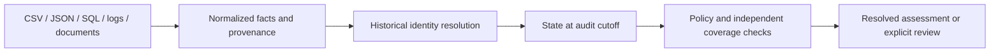

# Ghost Data — Evidence-Based Deletion Audit

A local Python batch pipeline that checks whether personal-data deletion is supported by the available evidence. Built for HackerRank Orchestrate, October 2026, and adapted into a runnable portfolio project.

It connects current and historical identifiers, reconstructs resource states at an audit cutoff, applies supplied policies, and proposes verification steps. **It does not connect to production services or execute deletions.**

## Run the demo

Python 3.12 or later. No package installation, API key, cloud account, or OCR engine is required for the bundled demo.

```bash
git clone https://github.com/Vaibhav-Mathur-25/hackerrank-orchestrate-october26.git
cd hackerrank-orchestrate-october26
python code/main.py --demo
python run_tests.py
```

Open `demo-output/audit_report.json`. The demo uses fictional CSV, JSON, SQL and log evidence through the actual ingestion and audit pipeline.

| Demo case | Expected result | What it demonstrates |
|---|---|---|
| Changed email | INCOMPLETE | Old email resolves to the stable user; a marketing record still exists |
| Deleted account | COMPLETE within supplied evidence | A post-request lookup establishes absence |
| Disputed owner | Review required; status and steps withheld | Conflicting identity evidence blocks a deletion plan |
| Unknown restore policy | Review required; status and steps withheld | Backup presence alone does not establish restore safety |
| Correction request | NOT_APPLICABLE | Correcting a name does not authorize deletion |
| Future evidence | INCOMPLETE | A later absence cannot change an earlier audit |

For example, an unresolved result contains:

```json
{
  "case_id": "demo_disputed_owner",
  "review_required": true,
  "deletion_status": null,
  "steps": [],
  "actions_withheld": true,
  "execution_authorized": false
}
```

The complete report includes issue codes, subject IDs, input hashes, and all requests. `resolved_predictions.csv` contains only resolved assessments; its size is not full-dataset coverage. Even resolved plans are advisory and never authorize execution.

## How it works



- **Ingestion:** validates CSVs, parses JSON/logs, and queries SQLite snapshot exports in memory. Optional adapters extract PDF text and screenshot OCR.
- **Identity:** follows timestamped identifier changes using stable user IDs; names alone do not merge people.
- **Time:** requires both observation time and evidence availability to precede the cutoff. Workflow success is a claim, not a readback.
- **Policy:** distinguishes deletion, redaction, anonymization, retention, data flows and restore risks.
- **Output:** preserves evidence references and deterministic ordering; unresolved default results have no public verdict or action plan.

## Your own / challenge data

```bash
python code/main.py --dataset PATH_TO_DATASET --run-dir evaluation/runs/review
```

The input directory must use the schemas illustrated in `demo/dataset/`. Document evidence additionally needs `requirements-documents.txt` and Tesseract for PNGs. Those submission-era dependency pins have not been freshly installed here.

Legacy competition predictions are explicitly separate:

```bash
python code/main.py --competition-output --strict --dataset PATH_TO_CHALLENGE_DATASET
```

Competition mode retains the original fixed challenge row counts and CSV format. `--best-effort` and `--conditional-review` require `--competition-output`. Conditional candidates may include uncertain verdicts or ownership-dependent actions; their companion diagnostics are mandatory. They are scoring artifacts, not executable plans. Exit zero in this legacy workflow establishes structural publication, not semantic correctness. The default review workflow never calls the conditional-candidate exporter.

## Evidence and limitations

- Single-process, local batch prototype; no distributed throughput, production deployment or legal compliance certification is demonstrated.
- Coverage is limited to supplied evidence. Document adapters recognize particular layouts, and OCR can be ambiguous.
- The synthetic demo tests known scenarios; it does not estimate accuracy on unseen real-world data.
- Historical challenge metrics and current checks are distinguished in [evaluation notes](docs/evaluation.md). Hidden-test accuracy is unknown.
- Optional Gemini extraction exists and has mocked tests. Live end-to-end inference has not been demonstrated. CLI inference requires an explicit operator-verified `--gemini-model`; the demo does not use it.
- No challenge dataset, answers, transcripts, caches or old submission archives are added by this portfolio update. Existing starter data in the GitHub repository is inherited; this project makes no claim about permission to redistribute it.

## Authorship

Vaibhav Mathur directed the goals, architectural decisions and evaluation constraints. Substantial implementation, debugging, tests and this portfolio cleanup were produced with Codex assistance. The repository documents that assistance rather than claiming the code was written independently from scratch.

The original challenge specification remains in `problem_statement.md` on GitHub. Challenge text and data retain their original ownership; no new license is asserted for them.
